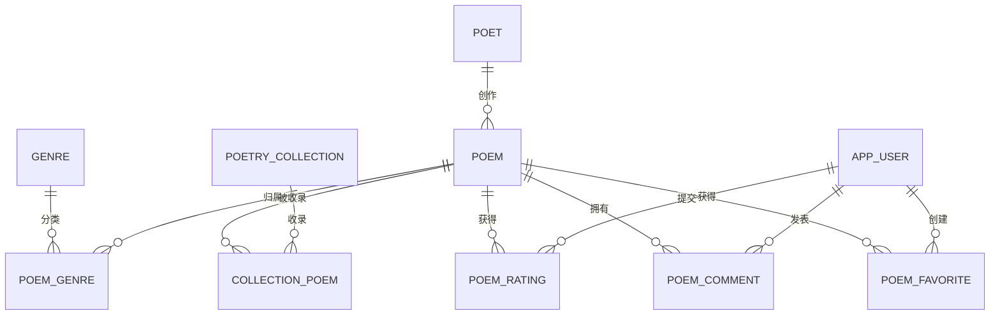

# E-R 图说明

本目录保存诗歌信息检索与赏析管理系统的 E-R 图源文件。字段和约束以 `../子任务1-3_需求与数据库设计.md` 为准。修改图定义后，在本目录依次运行 `python gen_er_drawio.py` 和 `python render_er_preview.py` 更新源图与预览。

| 文件 | 说明 |
|---|---|
| `诗歌系统ER图.drawio` | draw.io 源图，含初步 E-R 图及诗歌域、用户域基本 E-R 图 |
| `gen_er_drawio.py` | 根据实体和属性定义生成 draw.io 文件 |
| `render_er_preview.py` | 使用 Python 和 matplotlib 从 draw.io 图源渲染快速预览 |
| `_layout_preview.png` | 图源的快速预览；如修改图源需同步重新导出 |

## 记法与实体

矩形表示实体，菱形表示联系，椭圆表示属性；下划线表示主键，虚线椭圆表示派生属性。基本 E-R 图分诗歌域和用户域两页，合并理解即完整图。诗歌字数以虚线椭圆标示，仅作为 `CHAR_LENGTH(content)` 派生值，不在基础表中存储。

8 个核心实体：诗人、诗集、诗歌、流派、用户、评分记录、评论、收藏记录。另有两个多对多联系：诗歌—流派、诗集—诗歌。评分、评论、收藏分别由关联用户和诗歌的记录实体表示。

- 诗人：`poet_id`、姓名、笔名、性别、生年、卒年、国籍、朝代/时期、简介、创建/更新时间。
- 诗歌：`poem_id`、标题、正文、创作年份、体裁、赏析、作者、发布状态、创建/更新时间。字数是派生属性 `CHAR_LENGTH(content)`，不存储。
- 诗集：`collection_id`、名称、出版年份、出版社、ISBN、简介。
- 流派：`genre_id`、名称、描述。
- 用户：`user_id`、用户名、密码哈希、邮箱、角色、账户状态、注册时间。
- 评分记录：`rating_id`、用户、诗歌、1—5 分、评分时间、更新时间；用户与诗歌组合唯一。
- 评论：`comment_id`、用户、诗歌、内容、点赞统计值、创建/更新时间。点赞数不记录逐用户关系。
- 收藏记录：`favorite_id`、用户、诗歌、收藏时间、分类；用户与诗歌组合唯一。
- `poem_genre`：诗歌与流派的复合主键。
- `collection_poem`：诗集与诗歌的复合主键，另有 `sequence_no` 及诗集内顺序唯一约束。

## 联系与基数

| 联系 | 基数 | 关系数据库实现 |
|---|---|---|
| 诗人创作诗歌 | 1:N | `poem.poet_id` 外键 |
| 诗歌归属流派 | M:N | `poem_genre` |
| 诗集收录诗歌 | M:N | `collection_poem`，含篇目顺序 |
| 用户提交评分 / 诗歌获得评分 | 各 1:N | `poem_rating` 的两个外键 |
| 用户发表评论 / 诗歌拥有评论 | 各 1:N | `poem_comment` 的两个外键 |
| 用户创建收藏 / 诗歌被收藏 | 各 1:N | `poem_favorite` 的两个外键 |

## Mermaid 关系图

## 关系模式与规范化要点

1. `poet(poet_id, name, pen_name, gender, birth_year, death_year, nationality, dynasty, biography, created_at, updated_at)`
2. `poetry_collection(collection_id, collection_name, publication_year, publisher, isbn, description)`
3. `poem(poem_id, title, content, creation_year, poem_form, appreciation, poet_id, publication_status, created_at, updated_at)`
4. `genre(genre_id, genre_name, description)`
5. `app_user(user_id, username, password_hash, email, role, account_status, registered_at)`
6. `poem_rating(rating_id, user_id, poem_id, score, rated_at, updated_at)`
7. `poem_comment(comment_id, user_id, poem_id, content, like_count, created_at, updated_at)`
8. `poem_favorite(favorite_id, user_id, poem_id, favorited_at, favorite_type)`
9. `poem_genre(poem_id, genre_id)`
10. `collection_poem(collection_id, poem_id, sequence_no)`

各实体表由主键决定其余属性；名称、邮箱、ISBN 等候选键由唯一约束实现。联系表以复合主键避免重复关系。所有属性均为原子值，多值流派和诗集成员通过联系表表达；字数、评分统计等可计算值不重复存储。按设计文档中的函数依赖分析，关系模式满足 3NF。
