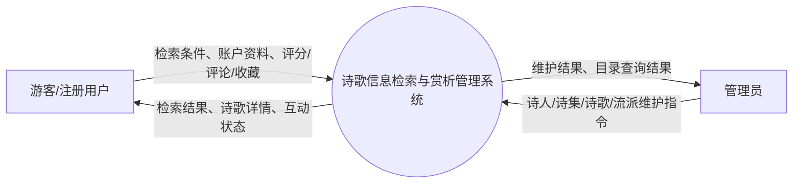
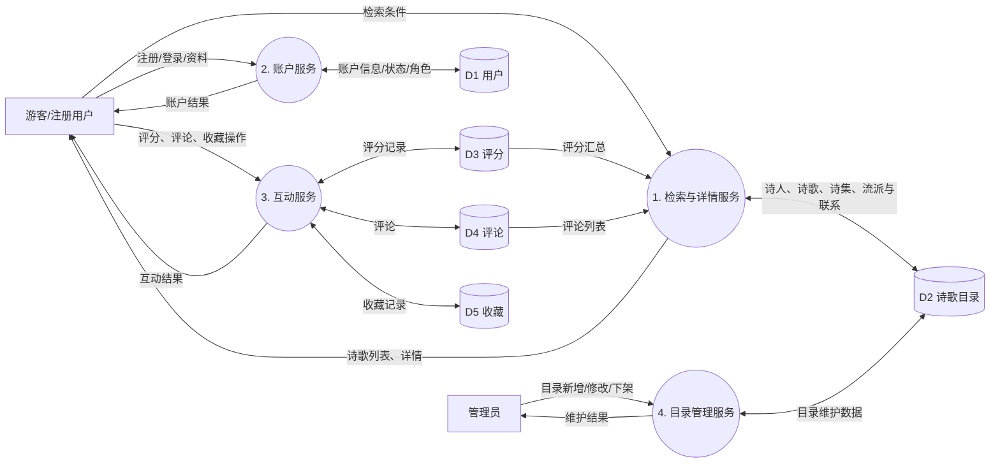
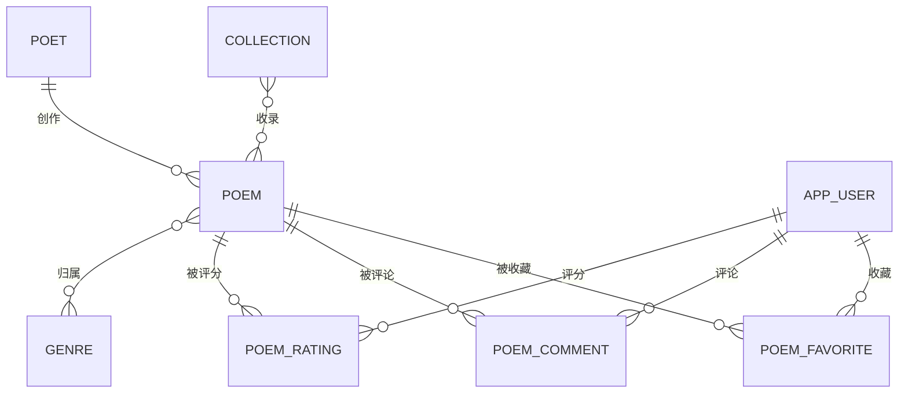
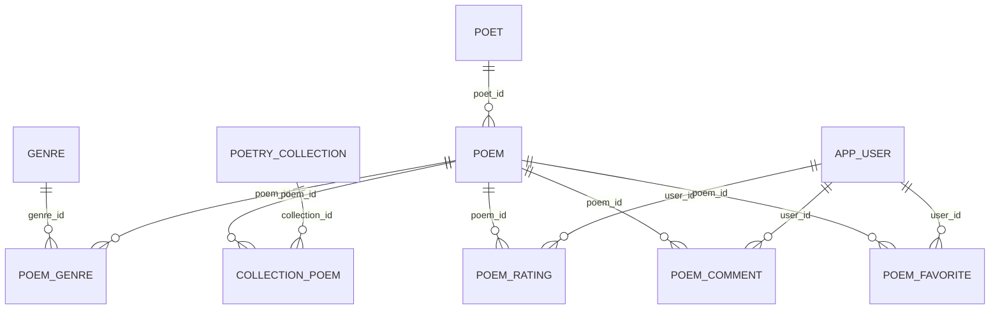
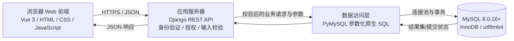

# 诗歌信息检索与赏析管理系统

## 子任务 1–3：需求分析、数据库设计与总体架构

> 本设计按选题提交材料中的 8 个核心实体建模。诗歌-流派、诗集-诗歌是多对多联系，关系数据库实现时分别增加 `poem_genre`、`collection_poem` 两张联系表；这两张表是联系的实现，不另计核心实体。

## 设计边界与业务规则

1. 游客可以检索、查看已发布诗歌及其关联信息；注册用户可评分、评论和收藏；管理员可维护诗人、诗集、诗歌、流派和用户状态。
2. 每首诗恰有一位主要作者；诗歌可属于多个流派，也可收录在多本诗集中。
3. 一个用户对同一首诗最多保留一条评分，评分范围为 1–5；修改评分更新原记录。
4. 一个用户对同一首诗最多保留一条收藏记录；收藏类型是用户给收藏加的分类标签。
5. 诗歌下架采用状态变更，不物理删除诗歌。已有关联评分、评论或收藏的诗歌保留历史；被外键引用的用户、诗人等基础记录不直接删除。
6. 用户密码字段保存后端计算的密码哈希，不保存明文。用户角色和账户状态用于服务端授权与停用账户。
7. 诗歌字数由正文派生，在查询时计算 `CHAR_LENGTH(content)`，不单独存储，避免正文修改后字数不同步；按 Unicode 字符数统计，标点、空格和换行也计入。
8. 评论点赞数保留为导入/统计用计数。第一版不记录“哪个用户点赞了哪条评论”，因此不提供逐用户点赞与防重复点赞功能。
9. 诗人姓名、诗歌标题和诗集名称不假定全球唯一；同名诗人、同名诗作或不同版本诗集可以共存。诗集 ISBN 存在时唯一，录入前去除连字符并统一大写 `X`。
10. 用户名和邮箱按 `utf8mb4_0900_ai_ci` 规则进行不区分大小写的唯一性校验；管理员角色只能由已授权的后台操作赋予，不能由公开注册接口指定。

## 子任务 1：系统需求分析

### 1.1 需求描述

本系统面向诗歌资料检索与阅读场景，维护诗人、诗集、诗歌和流派目录，并提供用户互动记录。核心数据应支持按标题、诗人、流派、创作年代、诗集和正文组合检索；诗歌详情页展示正文、赏析、作者、流派、收录诗集、平均评分和评论。系统不处理音频、图片文件托管、支付、推荐算法或复杂社交关系。

### 1.2 参与者与功能设计

| 参与者 | 功能模块 | 主要操作 |
|---|---|---|
| 游客 | 诗歌检索与浏览 | 按标题、诗人、流派、年代、诗集和正文检索；查看已发布诗歌详情、赏析及公开评分/评论 |
| 注册用户 | 账户管理 | 注册、登录、修改个人资料、退出；查看账户状态 |
| 注册用户 | 诗歌互动 | 对诗歌评分、修改自己的评分；发表评论、修改或删除自己的评论；收藏或取消收藏、修改收藏类型 |
| 管理员 | 基础目录管理 | 对诗人、诗集、流派执行增删改查；对诗歌执行新增、修改和下架；维护用户状态与角色 |
| 管理员 | 内容维护 | 按诗歌、诗人、诗集和流派检索后台目录；在外键限制允许时删除无引用记录；保留被互动记录引用的历史数据 |

### 1.3 功能需求编号

| 编号 | 需求 | 主要数据 | 数据库侧规则 |
|---|---|---|---|
| FR-01 | 注册与登录 | 用户 | 用户名和邮箱唯一；密码只保存哈希；仅启用账户可登录 |
| FR-02 | 诗歌基础信息维护 | 诗人、诗歌 | 诗歌必须关联一个存在的诗人；下架通过状态字段完成 |
| FR-03 | 诗集维护与收录 | 诗集、诗歌 | 一本诗集可收录多首诗，一首诗可进入多本诗集；诗集内顺序可维护 |
| FR-04 | 流派维护与归类 | 流派、诗歌 | 流派名称唯一；诗歌和流派多对多 |
| FR-05 | 多条件检索 | 诗歌及关联数据 | 可组合标题、诗人、流派、创作年份、诗集条件；分页返回结果 |
| FR-06 | 正文全文检索 | 诗歌正文 | 支持中文全文检索；短于分词粒度的输入由应用层以普通匹配兜底 |
| FR-07 | 诗歌详情 | 诗歌、诗人、流派、诗集、评分、评论 | 平均分和评分数由评分表聚合计算，不冗余存储 |
| FR-08 | 评分 | 用户、评分记录、诗歌 | 同一用户-诗歌组合唯一；分数必须为 1–5 |
| FR-09 | 评论 | 用户、评论、诗歌 | 评论关联现存用户和诗歌；正文非空；用户只修改或删除自己的评论，管理员可维护内容 |
| FR-10 | 收藏 | 用户、收藏记录、诗歌 | 同一用户-诗歌组合唯一；取消收藏删除对应记录 |
| FR-11 | 用户资料与状态 | 用户 | 停用账户不删除用户历史互动；角色由服务端校验 |

### 1.4 质量属性与约束

- **一致性：** 主键、外键、唯一约束、检查约束由 MySQL 保障；写入多条相关数据时使用事务。
- **安全性：** 浏览器不得直连数据库；服务器使用参数化 SQL；密码哈希、角色校验和账户状态检查由服务端实施。
- **可用性：** 诗歌、诗人及互动查询提供分页；目录检索和用户互动使用明确、可解释的查询条件。
- **本地化：** 数据库使用 `utf8mb4`；年份字段允许负数以表达公元前创作年份，未知年份用 `NULL`。
- **可维护性：** 多对多关系独立建表；评分均值、字数等派生信息由查询计算，避免双写。
- **规模假设：** 面向课程大作业的中等规模单库应用；不做分库分表和分布式全文搜索。

### 1.5 数据流图

#### 图 1：系统上下文图

#### 图 2：一级数据流图

### 1.6 数据元素表

类型和可空性为逻辑/物理设计基线；`PK` 为主键，`FK` 为外键，`UQ` 为唯一约束，`NN` 为非空。时间字段统一使用 `DATETIME`，默认当前时间。字符字段使用 `utf8mb4`。

#### 诗人 `poet`

| 属性 | 类型 | 可空 | 约束 | 含义 |
|---|---|---:|---|---|
| `poet_id` | `BIGINT UNSIGNED` | 否 | PK，自增 | 诗人编号 |
| `name` | `VARCHAR(100)` | 否 | NN | 姓名 |
| `pen_name` | `VARCHAR(100)` | 是 |  | 笔名 |
| `gender` | `VARCHAR(20)` | 是 |  | 性别或未详 |
| `birth_year` | `SMALLINT` | 是 |  | 生年，负数表示公元前 |
| `death_year` | `SMALLINT` | 是 |  | 卒年，负数表示公元前 |
| `nationality` | `VARCHAR(64)` | 是 |  | 国籍/所属国家地区 |
| `biography` | `TEXT` | 是 |  | 简介 |
| `created_at` | `DATETIME` | 否 | 默认当前时间 | 创建时间 |
| `updated_at` | `DATETIME` | 否 | 默认并自动更新 | 最近修改时间 |

#### 诗集 `poetry_collection`

| 属性 | 类型 | 可空 | 约束 | 含义 |
|---|---|---:|---|---|
| `collection_id` | `BIGINT UNSIGNED` | 否 | PK，自增 | 诗集编号 |
| `collection_name` | `VARCHAR(200)` | 否 | NN，普通索引 | 诗集名称 |
| `publication_year` | `SMALLINT UNSIGNED` | 是 |  | 出版年份 |
| `publisher` | `VARCHAR(200)` | 是 |  | 出版社 |
| `isbn` | `VARCHAR(20)` | 是 | UQ | ISBN；未提供时为空 |
| `description` | `TEXT` | 是 |  | 简介 |

#### 诗歌 `poem`

| 属性 | 类型 | 可空 | 约束 | 含义 |
|---|---|---:|---|---|
| `poem_id` | `BIGINT UNSIGNED` | 否 | PK，自增 | 诗歌编号 |
| `title` | `VARCHAR(255)` | 否 | NN，全文索引 | 标题 |
| `content` | `MEDIUMTEXT` | 否 | NN，中文全文索引 | 正文 |
| `creation_year` | `SMALLINT` | 是 |  | 创作年份；负数表示公元前 |
| `poem_form` | `VARCHAR(40)` | 是 |  | 体裁/形式 |
| `appreciation` | `TEXT` | 是 |  | 赏析 |
| `poet_id` | `BIGINT UNSIGNED` | 否 | FK → `poet` | 主要作者 |
| `publication_status` | `ENUM('published','withdrawn')` | 否 | 默认 `published` | 发布/下架状态 |
| `created_at` | `DATETIME` | 否 | 默认当前时间 | 创建时间 |
| `updated_at` | `DATETIME` | 否 | 默认并自动更新 | 最近修改时间 |
| `word_count` | 派生值 | — | 查询表达式 | 正文字数 `CHAR_LENGTH(content)`，不存储 |

#### 流派 `genre`

| 属性 | 类型 | 可空 | 约束 | 含义 |
|---|---|---:|---|---|
| `genre_id` | `BIGINT UNSIGNED` | 否 | PK，自增 | 流派编号 |
| `genre_name` | `VARCHAR(100)` | 否 | NN，UQ | 流派名称 |
| `description` | `TEXT` | 是 |  | 流派描述 |

#### 用户 `app_user`

| 属性 | 类型 | 可空 | 约束 | 含义 |
|---|---|---:|---|---|
| `user_id` | `BIGINT UNSIGNED` | 否 | PK，自增 | 用户编号 |
| `username` | `VARCHAR(50)` | 否 | NN，UQ | 登录用户名 |
| `password_hash` | `VARCHAR(255)` | 否 | NN | 后端生成的密码哈希 |
| `email` | `VARCHAR(254)` | 否 | NN，UQ | 邮箱 |
| `role` | `ENUM('user','admin')` | 否 | 默认 `user` | 账户角色 |
| `account_status` | `ENUM('active','disabled')` | 否 | 默认 `active` | 账户状态 |
| `registered_at` | `DATETIME` | 否 | 默认当前时间 | 注册时间 |

#### 评分记录 `poem_rating`

| 属性 | 类型 | 可空 | 约束 | 含义 |
|---|---|---:|---|---|
| `rating_id` | `BIGINT UNSIGNED` | 否 | PK，自增 | 评分编号 |
| `user_id` | `BIGINT UNSIGNED` | 否 | FK；与诗歌编号组成 UQ | 评分用户 |
| `poem_id` | `BIGINT UNSIGNED` | 否 | FK；与用户编号组成 UQ | 被评分诗歌 |
| `score` | `TINYINT UNSIGNED` | 否 | CHECK 1–5 | 评分值 |
| `rated_at` | `DATETIME` | 否 | 默认当前时间 | 初次评分时间 |
| `updated_at` | `DATETIME` | 否 | 默认并自动更新 | 最近修改评分时间 |

#### 评论 `poem_comment`

| 属性 | 类型 | 可空 | 约束 | 含义 |
|---|---|---:|---|---|
| `comment_id` | `BIGINT UNSIGNED` | 否 | PK，自增 | 评论编号 |
| `user_id` | `BIGINT UNSIGNED` | 否 | FK → `app_user` | 评论作者 |
| `poem_id` | `BIGINT UNSIGNED` | 否 | FK → `poem` | 评论对象 |
| `content` | `TEXT` | 否 | 非空且最多 2000 字符 | 评论内容 |
| `like_count` | `INT UNSIGNED` | 否 | 默认 0 | 导入/统计点赞数 |
| `created_at` | `DATETIME` | 否 | 默认当前时间 | 评论时间 |
| `updated_at` | `DATETIME` | 否 | 默认并自动更新 | 最近修改时间 |

#### 收藏记录 `poem_favorite`

| 属性 | 类型 | 可空 | 约束 | 含义 |
|---|---|---:|---|---|
| `favorite_id` | `BIGINT UNSIGNED` | 否 | PK，自增 | 收藏编号 |
| `user_id` | `BIGINT UNSIGNED` | 否 | FK；与诗歌编号组成 UQ | 收藏用户 |
| `poem_id` | `BIGINT UNSIGNED` | 否 | FK；与用户编号组成 UQ | 被收藏诗歌 |
| `favorited_at` | `DATETIME` | 否 | 默认当前时间 | 收藏时间 |
| `favorite_type` | `VARCHAR(50)` | 否 | 默认“默认” | 收藏分类标签 |

#### 联系表 `poem_genre`

| 属性 | 类型 | 可空 | 约束 | 含义 |
|---|---|---:|---|---|
| `poem_id` | `BIGINT UNSIGNED` | 否 | 复合 PK，FK → `poem` | 诗歌编号 |
| `genre_id` | `BIGINT UNSIGNED` | 否 | 复合 PK，FK → `genre` | 流派编号 |

#### 联系表 `collection_poem`

| 属性 | 类型 | 可空 | 约束 | 含义 |
|---|---|---:|---|---|
| `collection_id` | `BIGINT UNSIGNED` | 否 | 复合 PK，FK → `poetry_collection` | 诗集编号 |
| `poem_id` | `BIGINT UNSIGNED` | 否 | 复合 PK，FK → `poem` | 诗歌编号 |
| `sequence_no` | `SMALLINT UNSIGNED` | 否 | 诗集内唯一；从 1 开始 | 诗集内编排顺序 |

## 子任务 2：数据库设计

### 2.1 概念结构设计

#### 实体联系及基数

| 联系 | 基数 | 参与约束/说明 |
|---|---|---|
| 诗人创作诗歌 | 诗人 1 : N 诗歌 | 每首诗必须且仅有一位主要作者；诗人可暂时没有诗歌 |
| 诗歌归属流派 | 诗歌 M : N 流派 | 两侧均可为零或多个；通过 `poem_genre` 实现 |
| 诗集收录诗歌 | 诗集 M : N 诗歌 | 两侧均可为零或多个；`collection_poem` 另存诗集内顺序 |
| 用户提交评分 | 用户 1 : N 评分记录 | 每条评分恰有一位用户；同一用户对同一诗歌最多一条 |
| 诗歌获得评分 | 诗歌 1 : N 评分记录 | 每条评分恰对应一首诗；诗歌可暂时没有评分 |
| 用户发表评论 | 用户 1 : N 评论 | 每条评论恰有一位作者；用户可暂时没有评论 |
| 诗歌拥有评论 | 诗歌 1 : N 评论 | 每条评论恰对应一首诗；诗歌可暂时没有评论 |
| 用户创建收藏 | 用户 1 : N 收藏记录 | 每条收藏恰有一位用户；同一用户对同一诗歌最多一条 |
| 诗歌被收藏 | 诗歌 1 : N 收藏记录 | 每条收藏恰对应一首诗；诗歌可暂时没有收藏 |

#### 图 3：系统初步 E-R 图（业务实体与联系）

实体属性以数据元素表为准。评分、评论、收藏均有独立编号、时间或业务属性，作为 8 个核心实体之一；诗歌-流派、诗集-诗歌是多对多联系。

#### 图 4：系统基本 E-R 图（关系数据库实现形式）

`poem_genre` 和 `collection_poem` 分别实现两个多对多联系；其余联系由外键实现。每一条评分、评论、收藏都且仅关联一个用户和一首诗歌。

### 2.2 逻辑结构设计：关系模式

记号：`PK` 主键，`FK` 外键，`AK` 候选键/备用唯一键。属性名与 SQL 文件一致。

1. `POET(poet_id PK, name, pen_name, gender, birth_year, death_year, nationality, biography, created_at, updated_at)`
2. `POETRY_COLLECTION(collection_id PK, collection_name, publication_year, publisher, isbn AK, description)`
3. `POEM(poem_id PK, title, content, creation_year, poem_form, appreciation, poet_id FK→POET, publication_status, created_at, updated_at)`；字数由 `content` 派生。
4. `GENRE(genre_id PK, genre_name AK, description)`
5. `APP_USER(user_id PK, username AK, password_hash, email AK, role, account_status, registered_at)`
6. `POEM_RATING(rating_id PK, user_id FK→APP_USER, poem_id FK→POEM, score, rated_at, updated_at, AK(user_id, poem_id))`
7. `POEM_COMMENT(comment_id PK, user_id FK→APP_USER, poem_id FK→POEM, content, like_count, created_at, updated_at)`
8. `POEM_FAVORITE(favorite_id PK, user_id FK→APP_USER, poem_id FK→POEM, favorited_at, favorite_type, AK(user_id, poem_id))`
9. `POEM_GENRE(poem_id PK/FK→POEM, genre_id PK/FK→GENRE)`
10. `COLLECTION_POEM(collection_id PK/FK→POETRY_COLLECTION, poem_id PK/FK→POEM, sequence_no, AK(collection_id, sequence_no))`

实体集与联系表的分解依据：诗歌-流派和诗集-诗歌都是多对多，不能仅靠任一侧的单个外键表示；使用复合主键确保一对组合只出现一次。诗集收录顺序是联系属性，放在 `collection_poem` 中。

### 2.3 函数依赖、范式判定与规范化

所有单表属性均为原子值，不在一个字段中保存流派编号列表、诗集列表或评论列表。主要函数依赖如下：

| 关系 | 主要函数依赖/候选键 |
|---|---|
| `poet` | `poet_id → name, pen_name, gender, birth_year, death_year, nationality, biography, created_at, updated_at` |
| `poetry_collection` | `collection_id → collection_name, publication_year, publisher, isbn, description`；ISBN 非空时 `isbn → collection_id` |
| `poem` | `poem_id → title, content, creation_year, poem_form, appreciation, poet_id, publication_status, created_at, updated_at` |
| `genre` | `genre_id → genre_name, description`；`genre_name → genre_id, description` |
| `app_user` | `user_id → username, password_hash, email, role, account_status, registered_at`；`username → user_id, …`；`email → user_id, …` |
| `poem_rating` | `rating_id → user_id, poem_id, score, rated_at, updated_at`；`(user_id, poem_id) → rating_id, score, rated_at, updated_at` |
| `poem_comment` | `comment_id → user_id, poem_id, content, like_count, created_at, updated_at` |
| `poem_favorite` | `favorite_id → user_id, poem_id, favorited_at, favorite_type`；`(user_id, poem_id) → favorite_id, favorited_at, favorite_type` |
| `poem_genre` | `(poem_id, genre_id)` 为唯一候选键；无非键属性 |
| `collection_poem` | `(collection_id, poem_id) → sequence_no`；`(collection_id, sequence_no) → poem_id` |

- **1NF：** 每列只保存一个值。多值流派、诗集成员关系通过独立联系表表示。
- **2NF：** 单属性主键的实体表不存在对主键真子集的部分依赖；两个复合主键联系表中，`poem_genre` 没有非键属性，`collection_poem.sequence_no` 由完整的 `(collection_id, poem_id)` 决定。备用键 `(collection_id, sequence_no)` 也完整决定诗歌编号。
- **3NF：** 每个非平凡函数依赖的决定因素是候选键。作者国籍只存于 `poet`，不重复保存在 `poem`；评分均值、诗歌字数等派生值不作为冗余列存储。未发现非键属性对候选键的传递依赖。

因此，当前关系模式均满足 3NF。所选唯一约束均基于业务规则：用户名、邮箱、流派名、已提供 ISBN、用户-诗歌评分/收藏组合、诗集内序号。

### 2.4 物理结构与访问方法

#### 存储和数据类型

- 采用 MySQL 8.0.16+ 与 InnoDB；8.0.16 起执行 `CHECK` 约束。所有表使用 `utf8mb4`，支持中文正文和表情字符。
- 自增主键使用 `BIGINT UNSIGNED`；用户、诗人、诗歌等引用列类型完全一致。
- 诗歌正文使用 `MEDIUMTEXT`，赏析/简介/评论使用 `TEXT`；不将长正文放进索引键。
- 外键对更新级联，删除基础实体默认限制。删除无关的多对多联系行时允许级联；诗歌下架通过 `publication_status='withdrawn'` 实现。
- 日期和时间使用 `DATETIME`；历史年份使用有符号 `SMALLINT`，`NULL` 表示未知。

#### 索引设计

| 表 | 索引 | 方法/用途 |
|---|---|---|
| `poet` | PK；`idx_poet_name(name)` | B+Tree；按姓名查找。姓名包含匹配仍需扫描候选项 |
| `poetry_collection` | PK；`idx_collection_name(collection_name)`；`UNIQUE(isbn)` | B+Tree；诗集名称匹配、ISBN 精确查询 |
| `poem` | PK；`idx_poem_poet_year(poet_id, creation_year)`；`idx_poem_year(creation_year)`；标题/正文 ngram 全文索引 | B+Tree 支持作者、年份和组合筛选；InnoDB FULLTEXT ngram 支持中文标题和正文检索 |
| `genre` | PK；`UNIQUE(genre_name)` | B+Tree；名称精确查找 |
| `app_user` | PK；`UNIQUE(username)`；`UNIQUE(email)` | B+Tree；登录标识精确查找并保证唯一 |
| `poem_genre` | `PK(poem_id, genre_id)`；`idx_poem_genre_genre(genre_id, poem_id)` | 复合 B+Tree；支持从诗歌查流派及从流派查诗歌 |
| `collection_poem` | `PK(collection_id, poem_id)`；`UNIQUE(collection_id, sequence_no)`；`idx_collection_poem_poem(poem_id, collection_id)` | 复合 B+Tree；支持诗集内有序读取和反向查诗集 |
| `poem_rating` | `UNIQUE(user_id, poem_id)`；`idx_rating_poem_score(poem_id, score)` | 防止重复评分；覆盖按诗歌统计分数 |
| `poem_comment` | `idx_comment_poem_time(poem_id, created_at, comment_id)`；`idx_comment_user_time(user_id, created_at)` | 支持详情页按时间倒序列评论和用户评论列表 |
| `poem_favorite` | `UNIQUE(user_id, poem_id)`；`idx_favorite_poem(poem_id)` | 支持用户收藏列表、去重和按诗歌统计 |

MySQL 的 `ngram` FULLTEXT parser 对中文按 n-gram 分词。标题/正文长文本搜索使用 `MATCH ... AGAINST`；短词、标点或前缀补全由应用层以 `LIKE` 兜底，避免误以为普通 B+Tree 能加速 `%关键词%`。组合检索采用关系表连接和上述外键方向索引，返回结果分页。平均分和评分数量通过 `GROUP BY poem_id` 聚合。

## 子任务 3：系统总体架构设计

### 3.1 总体结构

采用浏览器-应用服务器-数据库三层结构。Web 前端使用 Vue 3/HTML/CSS/JavaScript；服务端使用 Django 5.2 暴露 REST/JSON API，通过 PyMySQL 执行显式参数化原生 SQL；数据库使用 MySQL 8.0.16+。Django 仅用于数据库连接、路由、请求处理和会话，不得用 ORM（models、filter、QuerySet、migrations）自动生成本项目的表结构或替代数据操作 SQL。

### 3.2 分层职责

| 层 | 主要职责 |
|---|---|
| Web 前端 | 展示搜索表单、诗歌列表/详情、登录注册、评分/评论/收藏和管理员目录页面；只调用服务端 API，不持有数据库凭据 |
| REST API | 会话/令牌认证、角色与所有权校验、参数校验、分页、业务错误转换；将用户输入绑定为 SQL 参数 |
| 业务服务 | 编排目录维护和互动用例；在多条数据库操作之间使用事务；评分修改按唯一键更新，不插入重复行 |
| SQL 数据访问层 | 保存显式 `SELECT/INSERT/UPDATE/DELETE` 原生 SQL；集中管理参数绑定、行数检查和结果映射；不使用 ORM |
| MySQL 数据层 | 通过主键、唯一键、外键、检查约束和索引维护完整性与查询性能；仅允许应用服务器网络访问 |

### 3.3 主要 API 与数据库读写边界

| 用例 | 建议 API | 数据访问概要 |
|---|---|---|
| 条件检索诗歌 | `GET /api/poems` | 查询 `poem` 并连接 `poet`；按需 `EXISTS` 过滤流派/诗集；只返回 `published`；分页排序 |
| 正文检索 | `GET /api/poems/fulltext?keyword=...` | `MATCH(title) AGAINST(...)` 或 `MATCH(content) AGAINST(...)`，同时限制为已发布诗歌 |
| 查看诗歌详情 | `GET /api/poems/{poemId}` | 查诗歌和诗人；通过联系表读取流派/诗集；聚合评分；读取分页评论 |
| 用户注册/登录 | `POST /api/auth/register`, `POST /api/auth/login` | 检查用户名/邮箱唯一；读取哈希和账户状态；哈希比对在服务端完成 |
| 评分/修改评分 | `PUT /api/poems/{poemId}/rating` | 按已认证 `user_id` 写入；利用唯一键执行更新或返回重复冲突 |
| 评论/修改/删除 | `POST /api/poems/{poemId}/comments`, `PUT/DELETE /api/comments/{commentId}` | 以会话用户为评论归属；更新和删除同时校验所有权或管理员角色 |
| 收藏/取消收藏 | `POST/DELETE /api/poems/{poemId}/favorite` | 利用 `(user_id, poem_id)` 唯一键去重；删除只命中当前用户记录 |
| 后台目录维护 | `POST/PUT/DELETE /api/admin/...` | 仅管理员访问；删除受外键限制；诗歌下架更新状态字段 |

### 3.4 运行与安全边界

- 浏览器与应用服务器通过 HTTPS 传送 JSON；应用服务器验证身份和角色后才执行写入。
- 应用服务器复用 MySQL 连接。数据库账户只授予应用所需的最小权限；数据库端口不直接对公网开放。
- 所有 SQL 使用参数绑定；动态排序字段采用服务端白名单映射，不能直接拼接用户输入。
- 注册时应用服务器使用密码哈希算法处理密码；敏感凭证放在 `.env` 或环境变量中，不写入前端代码或 SQL 文件。
- 诗集编排等涉及多条语句的操作使用事务存储过程。外键/唯一/检查约束负责最后一道完整性校验。
- 数据库定期备份；测试与正式数据分离。管理员删除或下架行为应保留业务记录，具体审计日志可在服务器开发子任务中扩展。

