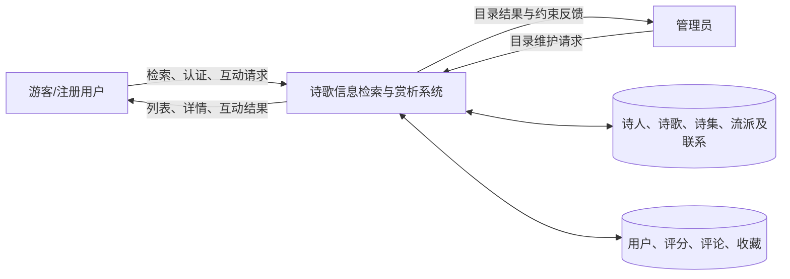

# 01 需求分析素材

> 本文对照 `../子任务1-3_需求与数据库设计.md` 编写，作为课程报告第一章素材。字段级数据字典和关系依赖以该设计说明为准。

## 1. 系统目标与用户需求

系统面向诗歌信息检索、赏析浏览和读者互动，包含游客、注册用户和管理员三类使用者。

| 角色 | 主要需求 |
|---|---|
| 游客 | 按标题、诗人、创作年份、体裁、流派、诗集检索；查看诗歌详情、赏析和公开互动统计 |
| 注册用户 | 注册和登录；对诗歌评分、评论和收藏，并管理自己的互动记录 |
| 管理员 | 维护诗人、诗集、诗歌和流派；通过发布状态下架诗歌 |

非功能需求包括：使用参数化 SQL 防止注入；密码只保存哈希；通过角色与资源归属检查限制操作；用主外键、唯一键、检查约束和事务保证数据完整性。

## 2. 功能结构

| 模块 | 功能 |
|---|---|
| 检索和浏览 | 多条件组合筛选、标题/正文检索、分页排序、详情和赏析 |
| 用户互动 | 评分与改分、评论增删改、收藏与取消收藏 |
| 目录管理 | 管理诗人、诗集、诗歌、流派；诗歌支持发布和下架 |
| 统计展示 | 计算平均分、评分数、评论数、收藏数；展示由正文派生的字符数 |

## 3. 数据流图

## 4. 数据范围与关键规则

数据库包含 8 个核心实体和 2 个多对多联系表：`poet`、`poetry_collection`、`poem`、`genre`、`app_user`、`poem_rating`、`poem_comment`、`poem_favorite`、`poem_genre`、`collection_poem`。主要关系为诗人—诗歌 1:N、诗歌—流派 M:N、诗集—诗歌 M:N；互动记录各关联一个用户和一首诗歌。

- 诗歌正文存于 `poem.content`；`word_count` 通过 `CHAR_LENGTH(content)` 派生，不写回表。
- 每位诗歌记录对应一位主要作者。流派和诗集成员通过联系表建模。
- 同一用户对同一首诗最多一条评分和一条收藏，由复合业务唯一约束实现。
- 诗歌下架使用 `publication_status='withdrawn'`；外键限制会阻止存在互动记录时物理删除诗歌或用户。
- 用户名和邮箱按不区分大小写方式唯一比较；ISBN 入库前去掉连字符并将末位 `x` 规范为大写 `X`。
- 评论 `like_count` 仅为导入或统计值，不构成逐用户点赞功能。
- 生年、卒年和创作年份采用有符号 `SMALLINT`，负数可表示公元前；未知年份用 `NULL`。

详细数据元素表、键、函数依赖和约束见子任务设计说明 §1 与 §2。
