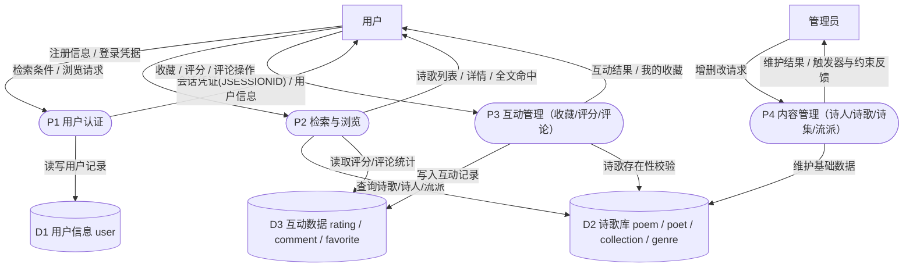

# 01 需求分析素材

> 对应《系统设计报告》第一章：需求描述 / 系统功能设计 / 数据流图 / 数据元素表。

## 1. 需求描述

### 1.1 系统背景与目标

本系统以诗歌信息管理为应用背景，面向**现代诗歌**建设一个中等规模的数据库应用系统。系统提供诗歌的多条件组合检索（标题/诗人/流派/年代/正文全文）、诗歌赏析浏览，以及注册用户的评分、评论、收藏互动；管理员负责诗人、诗歌、诗集、流派等基础数据的维护。通过本系统实践数据库设计的完整流程：需求分析 → E-R 建模 → 关系模式规范化（3NF）→ 物理设计 → 原生 SQL 实现（含触发器、存储过程、事务）。

### 1.2 用户角色与需求

| 角色 | 需求描述 |
| --- | --- |
| 游客（未登录） | 浏览与检索诗歌（标题/诗人/流派/年代/正文全文），查看诗歌详情（含作者、流派、平均分、评论），查看流派列表 |
| 注册用户 | 在游客能力之上：注册/登录；对诗歌评分与改分、取消评分；发表/修改/删除自己的评论；收藏/取消收藏；查看"我的收藏" |
| 管理员 | 诗人/诗歌/诗集/流派的新增、修改、删除（删除受数据库规则保护）；普通用户的一切互动能力（评论可删任意评论） |

### 1.3 非功能需求

- **安全性**：密码只存 BCrypt 哈希（不存明文）；未登录访问受保护接口返回 401，越权操作返回 403；防重复收藏/评分由应用校验 + 数据库 UNIQUE 约束双保险；防止 SQL 注入（全部参数化查询 `#{}`）。
- **数据完整性**：主键/外键/UNIQUE/CHECK/ENUM 约束 + 触发器业务规则（字数自动维护、删除保护、评分时间合法性）。
- **可扩展性**：数据层与逻辑层分离（MyBatis XML 手写 SQL），后续系统化建设诗歌库时仅需扩充数据与索引，应用层无需改动。

## 2. 系统功能结构

| 功能模块 | 功能点 | 对应接口（共 32 个） |
| --- | --- | --- |
| 检索与浏览 | 组合检索（标题/诗人/流派/年代，分页，3 种排序）；中文全文检索；诗歌详情；流派列表 | `GET /api/poems`、`GET /api/poems/fulltext`、`GET /api/poems/{id}`、`GET /api/genres` |
| 用户认证 | 注册；登录；当前用户；登出 | `POST /api/auth/register`、`POST /api/auth/login`、`GET /api/auth/me`、`POST /api/auth/logout` |
| 互动 | 收藏/取消/我的收藏；评分/改分/我的评分/取消；评论列表/发表/修改/删除 | `POST·DELETE /api/poems/{id}/favorite`、`GET /api/favorites`；`PUT·GET·DELETE /api/poems/{id}/rating`；`GET·POST /api/poems/{id}/comments`、`PUT·DELETE /api/comments/{id}` |
| 内容管理 | 诗人/诗歌/诗集/流派的增删改与列表（管理员） | `/api/admin/poets`、`/api/admin/poems`、`/api/admin/collections`、`/api/admin/genres`（共 14 个） |

完整接口清单（含方法、参数、响应）见 `02-系统架构与实现.md` §3。

## 3. 数据流图

> 报告插图建议在 draw.io 中按以下结构重绘（外部实体=矩形，加工=圆角框，数据存储=开口矩形/圆柱）。

### 3.1 顶层数据流图

### 3.2 0 层数据流图（系统分解为 4 个加工）

**加工说明**（报告配套文字）：
- P1 用户认证：调用存储过程 `sp_register_user` 完成注册（含用户名查重与 OUT 参数回填），登录采用 BCrypt 校验并建立会话；
- P2 检索与浏览：动态 SQL 多条件组合查询 + ngram 全文检索，评分/评论数由聚合查询实时计算；
- P3 互动管理：写操作要求登录（拦截器 401），评论改删校验属主（403），防重复由 UNIQUE 约束保证；
- P4 内容管理：仅管理员可用（403），删除受触发器与外键约束保护，无效请求在事务存储过程内整体回滚。

## 4. 数据元素表（数据字典）

> 类型为 MySQL 类型；报告排版时可按实体分组呈现。

| 数据项 | 含义 | 类型 | 取值/约束 | 所属表 |
| --- | --- | --- | --- | --- |
| poet_id | 诗人ID | BIGINT UNSIGNED | 主键，自增 | poet |
| name | 诗人姓名 | VARCHAR(50) | 非空 | poet |
| pen_name | 笔名 | VARCHAR(50) | 可空 | poet |
| gender | 性别 | ENUM('男','女') | 非空，默认'男' | poet |
| birth_year / death_year | 生年 / 卒年 | SMALLINT UNSIGNED | 卒年可为 NULL（在世诗人） | poet |
| nationality | 国籍 | VARCHAR(30) | 非空，默认'中国' | poet |
| biography | 简介 | TEXT | 可空 | poet |
| poem_id | 诗歌ID | BIGINT UNSIGNED | 主键，自增 | poem |
| title | 诗歌标题 | VARCHAR(100) | 非空；全文索引列 | poem |
| content | 诗歌正文 | MEDIUMTEXT | 非空；全文索引列 | poem |
| create_year | 创作年份 | SMALLINT UNSIGNED | 可空 | poem |
| form | 体裁 | VARCHAR(20) | 自由诗/散文诗/十四行诗等 | poem |
| word_count | 字数 | INT UNSIGNED | 非空，由触发器依据正文自动维护（反范式冗余） | poem |
| appreciation | 赏析 | TEXT | 可空 | poem |
| poet_id（外键） | 所属诗人 | BIGINT UNSIGNED | 外键→poet，删除受限 | poem |
| collection_id | 诗集ID | BIGINT UNSIGNED | 主键，自增 | collection |
| title（诗集） | 诗集名称 | VARCHAR(100) | 非空 | collection |
| publish_year | 出版年份 | SMALLINT UNSIGNED | 可空 | collection |
| publisher | 出版社 | VARCHAR(100) | 可空 | collection |
| isbn | ISBN | VARCHAR(20) | 全库唯一（UNIQUE） | collection |
| introduction | 简介 | TEXT | 可空 | collection |
| genre_id | 流派ID | BIGINT UNSIGNED | 主键，自增 | genre |
| name（流派） | 流派名称 | VARCHAR(50) | 非空，全库唯一 | genre |
| description | 流派描述 | VARCHAR(500) | 可空 | genre |
| user_id | 用户ID | BIGINT UNSIGNED | 主键，自增 | user |
| username | 用户名 | VARCHAR(30) | 非空，全库唯一 | user |
| password_hash | 密码哈希 | VARCHAR(255) | 非空，BCrypt 格式，严禁明文 | user |
| email | 邮箱 | VARCHAR(100) | 全库唯一（可空） | user |
| role | 角色 | ENUM('reader','admin') | 非空，默认 reader | user |
| status | 账户状态 | ENUM('active','banned') | 非空，默认 active | user |
| register_time | 注册时间 | DATETIME | 非空，默认当前时间 | user |
| rating_id | 评分记录ID | BIGINT UNSIGNED | 主键，自增 | rating |
| score | 评分 | TINYINT UNSIGNED | 1-5（CHECK 约束）；(user_id,poem_id) 唯一 | rating |
| rating_time | 评分时间 | DATETIME | 非空，默认当前时间，不得晚于当前（触发器校验） | rating |
| comment_id | 评论ID | BIGINT UNSIGNED | 主键，自增 | comment |
| content（评论） | 评论内容 | TEXT | 非空，应用层限 1000 字 | comment |
| comment_time | 评论时间 | DATETIME | 非空，默认当前时间 | comment |
| like_count | 点赞数 | INT UNSIGNED | 非空，默认 0 | comment |
| favorite_id | 收藏记录ID | BIGINT UNSIGNED | 主键，自增 | favorite |
| favorite_type | 收藏类型 | VARCHAR(20) | 默认/最爱/想读等 | favorite |
| favorite_time | 收藏时间 | DATETIME | 非空，默认当前时间 | favorite |
| (user_id, poem_id) | 联合唯一 | - | rating / favorite 各自约束，防重复互动 | rating / favorite |
| seq_no | 篇目序号 | SMALLINT UNSIGNED | 可空 | collection_poem |

## 5. 数据建设规划（后续系统化建库时替换本节）

当前数据为知名诗人名篇的**短篇节选**（仅教学演示）。系统化建库的规划路径：

1. **数据来源**：公版作品（作者逝世满 50 年）全文收录；在版权期内的作品仅收录题目、作者与元数据，或取得授权；
2. **采集**：公开诗词数据集筛选 / 结构化爬取 → 统一为 (标题, 作者, 正文, 年代, 体裁) 五元组；
3. **清洗**：去重（标题+作者）、繁简归一、去除 HTML 标记、作者名归一（别名映射到 poet 表）；
4. **批量导入**：小批量走 `INSERT`（触发器自动维护字数）；大规模走 `LOAD DATA INFILE` + 后置校验 SQL；
5. **校验**：导入后执行统计 SQL（总数/作者分布/年代分布/空值检查），并抽查全文检索召回效果。
