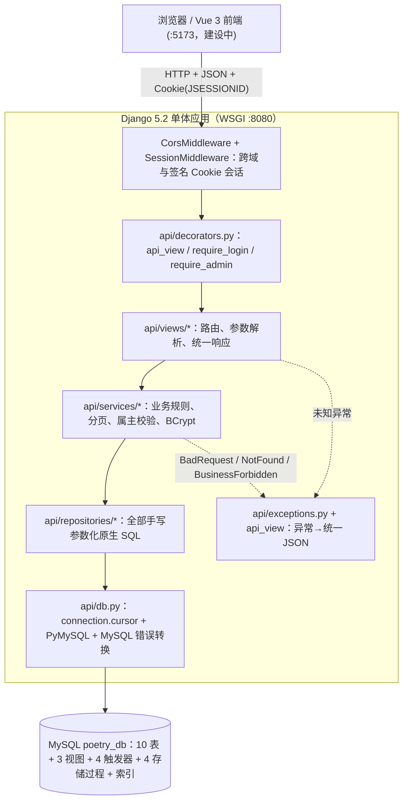

# 02 系统架构与实现素材

> 对应《系统实现报告》第一章。服务端已按本架构实现（Django 5.2 + PyMySQL，原生 SQL 手写于 `backend_django/api/repositories/`），并在 MySQL 9.7.1 上完成接口与数据库联测；字段与规则以 `../子任务1-3_需求与数据库设计.md` 为准。

## 1. 总体架构

## 2. 分层职责

| 层 | 职责 | 项目位置 |
| --- | --- | --- |
| Web 前端 | 检索、详情、认证、互动与管理页面；不保存数据库凭据 | `frontend/`（建设中） |
| 中间件 | CORS 白名单、OPTIONS 预检、签名 Cookie 会话 | `backend_django/api/middleware.py`、`backend_django/poetry_backend/settings.py` |
| 视图装饰器 | 统一响应、异常转换、未登录 401、非管理员 403 | `backend_django/api/decorators.py` |
| 视图 | HTTP 路由、查询参数/路径参数/JSON 解析、调用业务层 | `backend_django/api/views/` |
| 业务服务 | 分页归一、存在性检查（仅已发布诗歌可互动）、属主校验、防重复、BCrypt | `backend_django/api/services/` |
| 数据访问 | 全部 SQL 的原生实现：动态条件、视图、`CALL` 存储过程、upsert | `backend_django/api/repositories/` |
| 数据库连接 | Django `connection.cursor()` + PyMySQL；不经过 ORM | `backend_django/api/db.py`、`backend_django/poetry_backend/__init__.py` |
| 全局异常 | 业务异常(400/403/404)与未知异常(500)转统一 JSON，完整堆栈进日志 | `backend_django/api/exceptions.py`、`backend_django/api/decorators.py` |

## 3. 技术选型与运行环境

| 层次 | 技术 | 版本 | 选型理由 |
| --- | --- | --- | --- |
| DBMS | MySQL | 8.0.16+（实测 9.7.1 兼容） | 课程推荐；CHECK 约束 8.0.16 起强制生效；ngram 中文全文解析器 |
| 后端语言 | Python | 3.13 | 当前稳定版本 |
| 应用框架 | Django | 5.2 LTS | 主流 Python Web 框架；只用于路由、请求处理、会话与数据库连接 |
| 数据库驱动 | PyMySQL（含 `cryptography`） | 1.2.x | 纯 Python 驱动，支持 MySQL 8+ 的 `caching_sha2_password` |
| 持久层方式 | 手写参数化原生 SQL | — | 满足课程“所有数据库操作必须原生 SQL、禁止 ORM”的要求 |
| 密码哈希 | bcrypt | 5.0.x | 慢哈希 + 随机盐；兼容种子数据中的 `$2a$` 哈希 |
| 环境管理 | uv | 0.11.x | 依赖解析、虚拟环境与锁文件管理 |
| 会话 | Django signed-cookie session | — | Cookie 名保持 `JSESSIONID`，不创建 `django_session` 表 |
| 前端 | Vue 3 + Vite + Element Plus | Node 20 LTS | 主流方案（建设中，石朋松负责） |

**配置外置**：数据库密码不进 git。`backend_django/.env` 由 `python-dotenv` 加载，已被 `.gitignore` 排除；也可以直接使用系统环境变量。可配置项包括 `DB_NAME`、`DB_USER`、`DB_PASSWORD`、`DB_HOST`、`DB_PORT`、`DJANGO_SECRET_KEY`、`DJANGO_DEBUG`、`DJANGO_ALLOWED_HOSTS`、`SQL_DEBUG`。

**原生 SQL 合规说明**：项目没有定义任何业务 Django model，没有使用 `.objects`、`filter()`、`QuerySet`、`annotate()` 等 ORM 接口，也没有执行 `makemigrations` / `migrate`。建库、建表、索引、约束在 `sql/01`—`sql/03`；视图在 `sql/04`；触发器在 `sql/05`；存储过程在 `sql/06`；所有增删改查在 `backend_django/api/repositories/*.py` 中以参数化原生 SQL 执行。Django 仅承担数据库连接、路由、请求处理、会话和用户交互。

## 4. 接口清单（33 个）

统一响应：`{"code":200|400|401|403|404|500, "message":"...", "data":...}`

| 模块 | 方法与路径 | 权限 | 说明 |
| --- | --- | --- | --- |
| 检索 | GET /api/poems | 公开 | 组合检索（keyword/poetName/genre/yearFrom/yearTo/orderBy/page/pageSize），只返回已发布诗歌 |
| 检索 | GET /api/poems/fulltext?keyword= | 公开 | 中文全文检索，标题与正文两个 ngram 索引，按相关度排序 |
| 检索 | GET /api/poems/{id} | 公开 | 诗歌详情（查视图 v_poem_detail） |
| 检索 | GET /api/genres | 公开 | 流派列表 |
| 认证 | POST /api/auth/register | 公开 | 注册（用户名/密码/邮箱），调存储过程 sp_register_user（OUT 回填新ID） |
| 认证 | POST /api/auth/login | 公开 | BCrypt 校验，Set-Cookie(JSESSIONID, HttpOnly)，停用账户拒绝登录 |
| 认证 | GET /api/auth/me | 公开 | 当前用户（未登录 data=null） |
| 认证 | POST /api/auth/logout | 登录 | 清除签名 Cookie 会话 |
| 收藏 | POST/DELETE /api/poems/{id}/favorite | 登录 | 收藏/取消，UNIQUE(user_id,poem_id) 防重 |
| 收藏 | GET /api/favorites | 登录 | 我的收藏（分页，只显示仍已发布的作品） |
| 评分 | PUT /api/poems/{id}/rating?score= | 登录 | 评分/改分（ON DUPLICATE KEY 覆盖写），data=created/updated |
| 评分 | GET /api/poems/{id}/rating | 登录 | 我的评分 |
| 评分 | DELETE /api/poems/{id}/rating | 登录 | 取消评分 |
| 评论 | GET /api/poems/{id}/comments | 公开 | 评论分页列表（JOIN 用户名） |
| 评论 | POST /api/poems/{id}/comments | 登录 | 发表评论 |
| 评论 | PUT /api/comments/{id} | 登录+属主 | 修改自己的评论 |
| 评论 | DELETE /api/comments/{id} | 登录+属主/管理员 | 删除评论 |
| 管理 | GET/POST/PUT/DELETE /api/admin/poets | 管理员 | 诗人管理；删除有作品者被触发器拦截 |
| 管理 | POST/PUT/DELETE /api/admin/poems | 管理员 | 诗歌管理；字数查询时派生；物理删除受 RESTRICT 保护 |
| 管理 | PUT /api/admin/poems/{id}/status?value= | 管理员 | 下架/恢复（publication_status 状态变更，保留历史） |
| 管理 | GET/POST/PUT/DELETE /api/admin/collections | 管理员 | 诗集管理；新建调事务存储过程 |
| 管理 | POST/PUT/DELETE /api/admin/genres | 管理员 | 流派管理；UNIQUE 防重名 |

## 5. 关键实现机制（答辩讲解要点）

1. **BCrypt + 签名 Cookie 认证**：注册时 `bcrypt.hashpw(明文, gensalt(rounds=10))` 入库，登录时 `bcrypt.checkpw` 校验；成功后把 `userId/username/role` 写入签名 Cookie，Cookie 名 `JSESSIONID`，HttpOnly、SameSite=Lax、30 分钟过期。用户不存在与密码错误返回同一句提示，防用户名枚举；账户停用（`account_status='disabled'`）拒绝登录。
2. **端点级权限**：`api_view` 统一包装，`@require_login` / `@require_admin` 在进入视图前短路——未登录 HTTP 401，非管理员 HTTP 403，均返回统一 JSON。
3. **资源级权限**：Service 校验资源属主（如评论改删），非属主返回 body `code=403`（HTTP 200，与原契约一致），管理员删除放行；userId 一律取自签名会话，绝不接受前端传入。
4. **动态原生 SQL**：`backend_django/api/repositories/poem_repo.py` 用固定条件片段拼接 WHERE，所有值通过 `%s` 参数绑定；排序只接受服务端白名单映射，不拼接用户输入，防止 SQL 注入。检索、详情、互动统一附加 `publication_status='published'`。
5. **覆盖式写入（upsert）**：评分用 `INSERT ... ON DUPLICATE KEY UPDATE`，以受影响行数（1=新增/2=更新）区分 created/updated，消除“先查后插”的并发竞态。
6. **发布状态与保留历史**：下架 = `publication_status` 变更为 withdrawn；评分/评论/收藏外键为 RESTRICT，互动历史不随下架或账号停用丢失；物理删除仅适用于无关联记录的数据。
7. **派生值不落表**：字数 `CHAR_LENGTH(content)`、平均分、评论/收藏数均在视图或查询中计算；JSON 字段（createYear/form/wordCount 等）由 SQL 别名保持一致，前端不受表名调整影响。
8. **分层防御**：应用校验 → Service 预检 → 数据库约束（CHECK/UNIQUE/外键/ENUM）与触发器（SIGNAL/时间校验）→ 事务存储过程回滚；Django 侧把 MySQL SIGNAL/约束错误转换成友好提示。
9. **数据库对象实际使用**：详情查 `v_poem_detail`，诗集目录查 `v_collection_catalog`；注册调 `sp_register_user`，全文检索调 `sp_fulltext_search_poems`，新建诗集调事务存储过程 `sp_add_collection_with_poems`；删除诗人由 `trg_poet_bd` 拦截，评分时间由 `trg_rating_bi/bu` 校验。

## 6. 系统前端开发技术【石朋松补充】

> 联调后补充：Vue 3 组合式 API、路由与页面结构、axios 封装（baseURL、携带 Cookie）、登录态处理（GET /api/auth/me）、检索页/详情页/个人中心/管理页面的组件设计，并附页面截图。
>
> 当前仓库尚未包含前端代码；Django 服务端已按上述 33 个接口完成联调，前端接入时不需要修改接口字段或 Cookie 方案。
