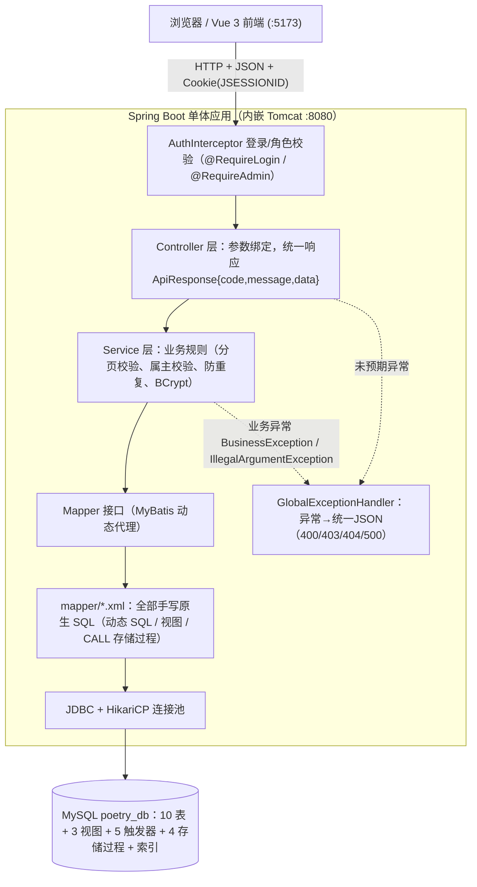

# 02 系统架构与实现素材

> 对应《系统实现报告》第一章：系统总体架构设计（架构图、DBMS、前后端框架、环境说明）与第五章部分内容。

## 1. 系统总体架构

### 1.1 架构图（Mermaid 源码，报告插图建议重绘）

### 1.2 分层职责

| 层 | 职责 | 项目位置 |
| --- | --- | --- |
| 拦截器 | 端点级权限：未登录 401、非管理员 403，短路响应 | `config/AuthInterceptor.java` |
| Controller | HTTP 路由、参数绑定（@RequestParam/@PathVariable/@RequestBody）、包装统一响应 | `controller/` |
| Service | 业务规则：分页参数归一、存在性检查、属主校验、防重复预检、密码哈希 | `service/` |
| Mapper | 数据访问接口（无手写实现类，由 MyBatis 动态代理） | `mapper/` |
| Mapper XML | **全部 SQL 的唯一出处**（课程"原生 SQL"要求的落点） | `resources/mapper/*.xml` |
| 全局异常 | 把业务异常(400/403/404)与未知异常(500)转为统一 JSON，完整堆栈进日志 | `common/GlobalExceptionHandler.java` |

## 2. 技术选型与运行环境

| 层次 | 技术 | 版本 | 选型理由 |
| --- | --- | --- | --- |
| DBMS | MySQL | 8.0.16+（实测 9.7.1 兼容） | 课程推荐；CHECK 约束 8.0.16 起强制生效；ngram 中文全文解析器 |
| 后端语言 | Java | 21 LTS | 长期支持版本 |
| 应用框架 | Spring Boot | 3.3.5 | 当前主流；内嵌 Tomcat；自动装配减少配置 |
| 持久层 | MyBatis（spring-boot-starter） | 3.0.4 | 只做 SQL↔对象映射，SQL 全部手写 XML——**不是 ORM，符合课程"原生 SQL"要求** |
| 密码哈希 | spring-security-crypto（BCrypt） | 6.3.4 | 慢哈希 + 随机盐；只引算法模块，不引整套 security 过滤器链 |
| 构建工具 | Maven | 3.9.9 | 依赖管理与标准化目录 |
| 数据库连接池 | HikariCP | Boot 默认 | 高性能，启动即建池 |
| 前端 | Vue 3 + Vite + Element Plus | 20 LTS Node | 主流方案（建设中，石朋松负责） |
| 接口调试 | Apifox / curl | - | 接口文档与冒烟测试 |

**配置外置**：数据库密码不进 git——`application.yml` 只含占位符 `${DB_PASSWORD:CHANGE_ME}` 与 `spring.config.import: optional:file:./application-local.yml`，真实密码在被 gitignore 的 `backend/application-local.yml`（每个组员各配各的）。

## 3. 接口清单（32 个）

统一响应：`{"code":200|400|401|403|404|500, "message":"...", "data":...}`

| 模块 | 方法与路径 | 权限 | 说明 |
| --- | --- | --- | --- |
| 检索 | GET /api/poems | 公开 | 组合检索（keyword/poetName/genre/yearFrom/yearTo/orderBy/page/pageSize），data 为分页结构 |
| 检索 | GET /api/poems/fulltext?keyword= | 公开 | 中文全文检索，按相关度排序 |
| 检索 | GET /api/poems/{id} | 公开 | 诗歌详情（查视图 v_poem_detail） |
| 检索 | GET /api/genres | 公开 | 流派列表 |
| 认证 | POST /api/auth/register | 公开 | 注册，调存储过程 sp_register_user（OUT 回填新ID） |
| 认证 | POST /api/auth/login | 公开 | 登录，BCrypt 校验，Set-Cookie(JSESSIONID, HttpOnly) |
| 认证 | GET /api/auth/me | 公开 | 当前用户（未登录 data=null） |
| 认证 | POST /api/auth/logout | 登录 | 销毁服务端会话 |
| 收藏 | POST /api/poems/{id}/favorite | 登录 | 收藏（可带 favoriteType），UNIQUE 防重 |
| 收藏 | DELETE /api/poems/{id}/favorite | 登录 | 取消收藏 |
| 收藏 | GET /api/favorites | 登录 | 我的收藏（分页，收藏时间倒序） |
| 评分 | PUT /api/poems/{id}/rating?score= | 登录 | 评分/改分（ON DUPLICATE KEY 覆盖写），data=created/updated |
| 评分 | GET /api/poems/{id}/rating | 登录 | 我的评分 |
| 评分 | DELETE /api/poems/{id}/rating | 登录 | 取消评分 |
| 评论 | GET /api/poems/{id}/comments | 公开 | 评论分页列表（JOIN 用户名） |
| 评论 | POST /api/poems/{id}/comments | 登录 | 发表评论 |
| 评论 | PUT /api/comments/{id} | 登录+属主 | 修改自己的评论 |
| 评论 | DELETE /api/comments/{id} | 登录+属主/管理员 | 删除评论 |
| 管理 | GET/POST/PUT/DELETE /api/admin/poets | 管理员 | 诗人管理；删除有作品者被触发器拦截 |
| 管理 | POST/PUT/DELETE /api/admin/poems | 管理员 | 诗歌管理；字数触发器自动维护；下架级联 |
| 管理 | GET/POST/PUT/DELETE /api/admin/collections | 管理员 | 诗集管理；新建调事务存储过程 |
| 管理 | POST/PUT/DELETE /api/admin/genres | 管理员 | 流派管理；UNIQUE 防重名 |

## 4. 关键实现机制（答辩讲解要点）

1. **BCrypt + Session 认证**：注册时 `passwordEncoder.encode(明文)`（自动随机盐）入库；登录时 `matches(明文, 库中哈希)` 校验；成功后身份写入 HttpSession，浏览器凭 JSESSIONID（HttpOnly）找回会话。用户不存在与密码错误返回同一句提示，防用户名枚举。
2. **声明式权限**：`@RequireLogin` / `@RequireAdmin`（支持方法级与类级）+ `AuthInterceptor.preHandle` 短路——未进入 Controller 就返回 401/403 JSON。
3. **资源级权限**：Service 层校验资源属主（如评论改删），非属主 403，管理员删除放行；userId 一律取自会话，绝不接受前端传入。
4. **动态 SQL**：`<if>/<where>/<choose>/<include>` 拼组合检索条件，参数全部 `#{}` 预编译占位符（防注入）。
5. **覆盖式写入（upsert）**：评分用 `ON DUPLICATE KEY UPDATE`，以受影响行数（1=新增/2=更新）区分 created/updated，消除"先查后插"的并发竞态。
6. **反范式与查询时计算的取舍**：字数冗余存储并由触发器维护（写多读少且要求一致性）；平均分/评论数/收藏数在查询时计算（变化频繁，避免联动维护）。
7. **分层防御**：应用校验 → Service 预检 → 数据库约束(CHECK/UNIQUE/外键)与触发器(SIGNAL) → 事务存储过程回滚，前端拿到的都是友好提示。

## 5. 系统前端开发技术【石朋松补充】

> 联调后补充：Vue 3 组合式 API、路由与页面结构、axios 封装（baseURL、携带 Cookie）、登录态处理（GET /api/auth/me）、检索页/详情页/个人中心/管理页面的组件设计，并附页面截图。
