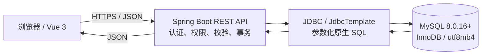

# 02 系统架构与实现素材

> 本文是子任务 3 的架构设计建议，不代表系统已按此方案部署或完成联调。数据库字段与规则以 `../子任务1-3_需求与数据库设计.md` 为准。

## 1. 总体架构

采用浏览器、应用服务器、数据库三层结构。前端建议 Vue 3；服务端建议 Spring Boot 提供 REST/JSON 接口，通过 JDBC 或 JdbcTemplate 执行参数化原生 SQL；数据库采用 MySQL 8.0.16+。

## 2. 分层职责

| 层 | 职责 |
|---|---|
| Web 前端 | 展示检索、诗歌详情、认证、互动和管理员目录页面；不保存数据库凭据 |
| REST 服务 | 身份认证、角色/归属校验、参数校验、分页和错误映射 |
| 业务服务 | 编排用户互动和目录维护；多语句操作按需使用事务 |
| SQL 访问层 | 显式编写参数化 SQL，并完成结果映射；不依赖 ORM 自动生成表结构或数据操作 |
| MySQL | 通过键、约束、索引和事务维护数据一致性并执行查询 |

## 3. 建议接口与数据库访问

| 用例 | 建议接口 | 数据访问概要 |
|---|---|---|
| 组合检索 | `GET /api/poems` | 查询已发布诗歌，连接 `poet`，按流派/诗集使用 `EXISTS` 筛选并分页 |
| 全文检索 | `GET /api/poems/search?q=...` | 使用标题或正文的 ngram FULLTEXT；短词/前缀由应用使用 LIKE 兜底 |
| 诗歌详情 | `GET /api/poems/{poemId}` | 查询诗人与诗歌；通过联系表读取流派、诗集；统计互动记录 |
| 注册和登录 | `POST /api/auth/register`、`POST /api/auth/login` | 写入哈希密码；验证账户状态；服务端执行哈希校验 |
| 评分 | `PUT /api/poems/{poemId}/rating` | 使用已认证用户 ID；由 `(user_id, poem_id)` 唯一键防止重复记录 |
| 评论 | `POST/PUT/DELETE /api/comments` | 以服务端身份确定作者；修改/删除检查归属或管理员权限 |
| 收藏 | `PUT/DELETE /api/poems/{poemId}/favorite` | 以用户和诗歌组合定位收藏记录 |
| 管理目录 | `POST/PUT/DELETE /api/admin/...` | 管理诗人、诗集、诗歌和流派；下架诗歌更新状态字段 |

## 4. 安全与事务边界

所有 SQL 参数应绑定而非拼接；排序字段由服务端白名单选择。数据库凭据保存在服务端环境或受保护配置中。数据库用户按应用所需授予最小权限，生产数据库不直接暴露到公网。诗集及其收录关系等多步写入放在事务中；数据库约束作为应用校验之后的完整性保障。